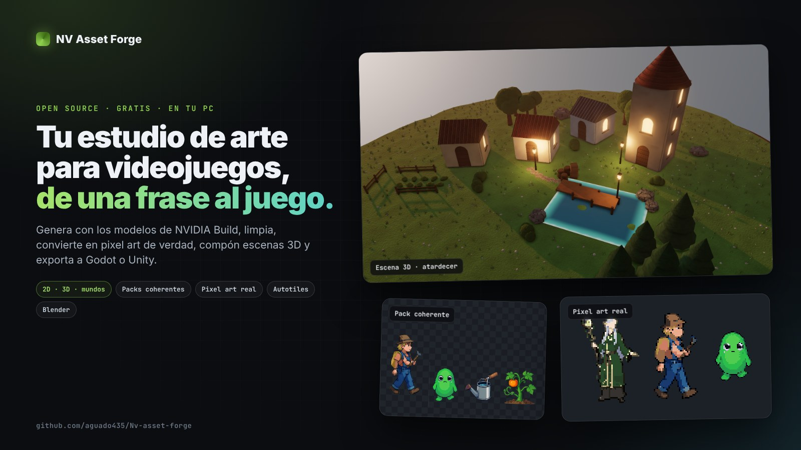
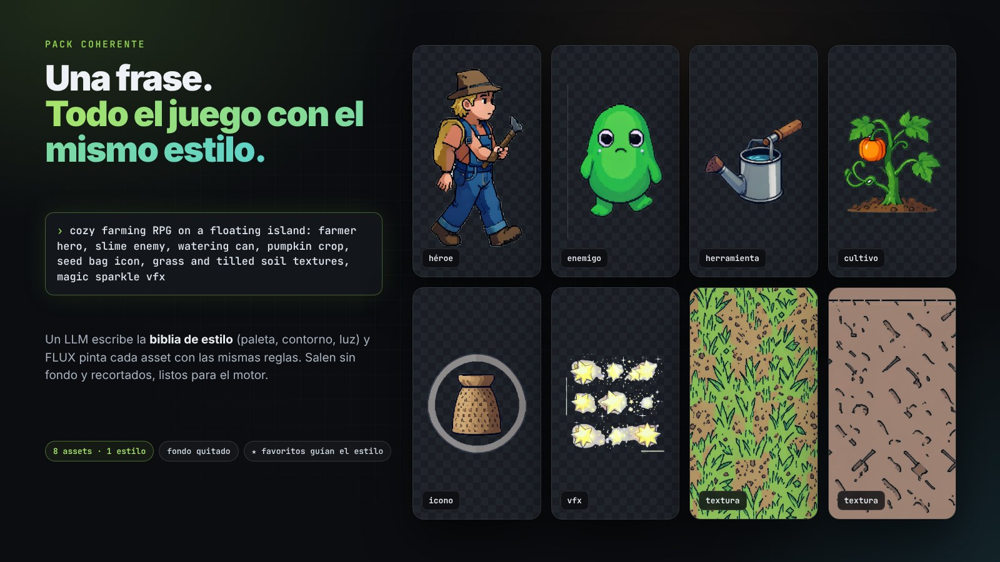
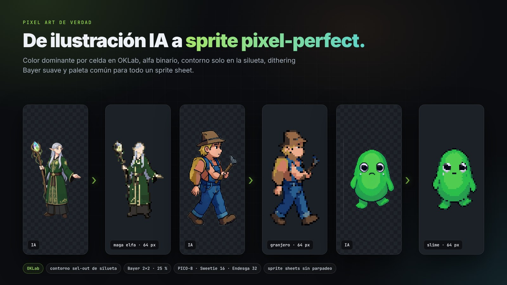
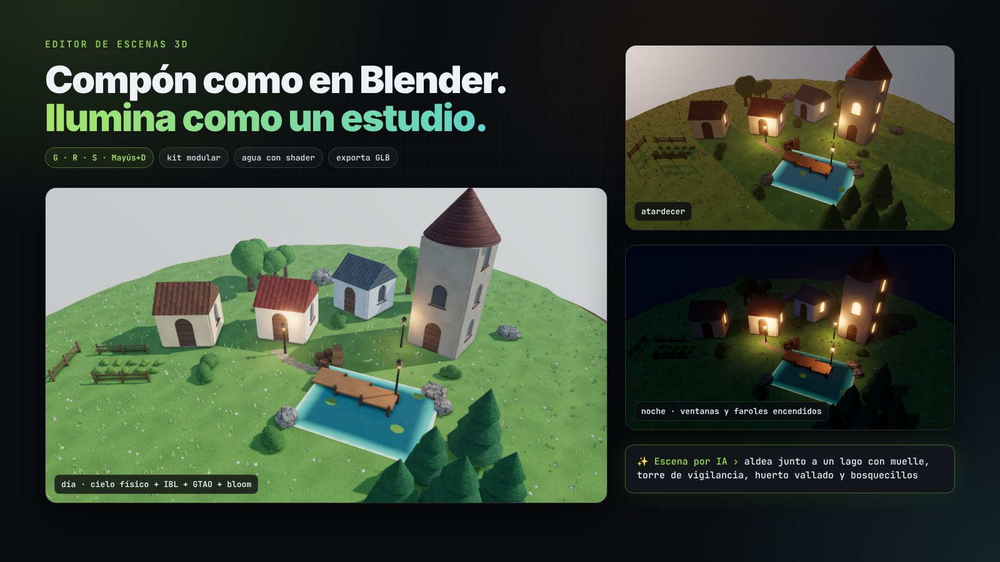
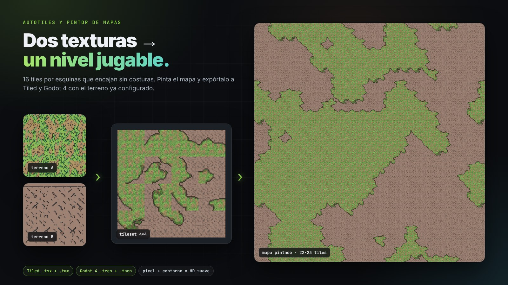
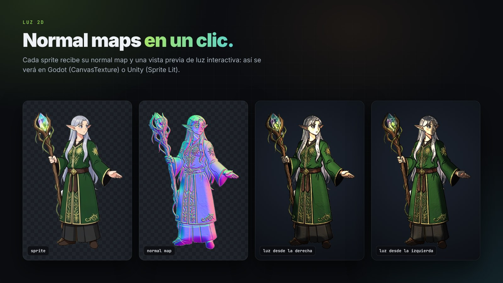
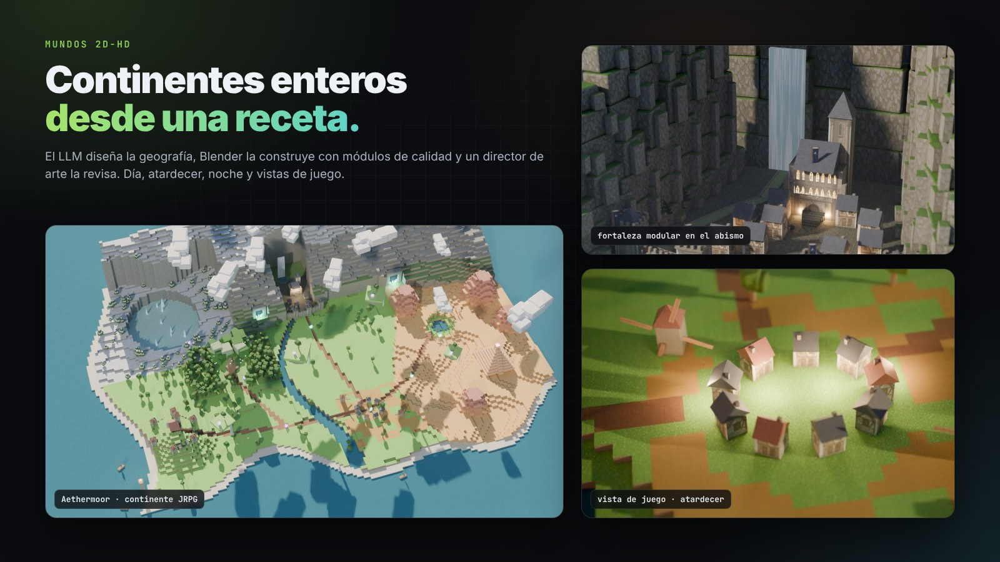

# NV Asset Forge

**A free, open-source 2D and 3D game art studio that runs on your PC.** Describe what you need (any language) and NV Asset Forge generates it with **NVIDIA Build** AI models, cleans it up, turns it into real pixel art, builds it in **Blender** and exports it to Godot or Unity. Characters, coherent asset packs, autotiles and maps, 3D models and whole 2D-HD worlds.

[Español](README.md) · **[Try Forge Lite in your browser](https://aguado435.github.io/Nv-asset-forge/#lite)** (no key, no install)

- **Free:** uses the free API at [build.nvidia.com](https://build.nvidia.com) with **your own key**.
- **Local:** the server runs on your computer, assets stay on your disk and your key never leaves your PC (except to NVIDIA).
- **Light:** only Node.js. Blender is optional but recommended.
- Windows, macOS and Linux.



| | |
|---|---|
|  |  |
|  |  |
|  |  |

*Everything on this page was made with NV Asset Forge: textures, facades and sprites with FLUX.2 on NVIDIA Build, worlds assembled and rendered in Blender with the scripts in `examples/`.*

---

## Features

| Feature | What it does | Runs on |
|---|---|---|
| **Coherent packs** | One sentence → an LLM writes a shared style bible and the asset list (hero, enemies, props, icons, textures, background, VFX); FLUX paints them all with the same visual rules | NVIDIA |
| **Studio recipes** | 26 tested starting prompts and 8 curated styles: HD-2D, cozy pixel, gothic metroidvania, grim painted fantasy, casual mobile, isometric, inked comic, storybook watercolor | — |
| **Learns from your favorites** | Star an asset and its prompt becomes an approved example for every new generation and pack in the project: the style converges without retraining | NVIDIA (LLM) |
| **Auto clean-up** | Sprites come back without background and cropped; VFX get luminance alpha; pixel styles also get a real pixel-art version at native resolution with a closed palette | Browser |
| **Job queue** | Run several jobs at once without blocking the app, with progress, per-job log and cancel (also stops Blender) | Local |
| **Autotiles** | Two textures → a seamless 16-tile corner terrain set (pixel with outline or soft HD) + Tiled `.tsx` + Godot 4 `.tres` with terrains configured | Browser |
| **AI scenes** | Describe the scene ("fishing village at dusk with a pier…") and the LLM composes it with houses, towers, piers, nature and lights; the server fixes overlaps and water. Then tweak it by hand or ask for changes | NVIDIA (LLM) + browser |
| **3D scene editor** | Blender-style editor in the browser: gizmos and G/R/S, Shift+D, X, H, F, Ctrl+Z shortcuts; outliner and properties; primitives, modular kit (walls, windows, doors, roofs, stairs, arches, columns, fences), nature and lights; GLB models from your library; your pack textures on any object; time of day; GLB export and save as an asset to optimize and render with Blender | Browser |
| **Map painter** | Paint levels with your autotiles (brush, random, undo) and save PNG, Tiled map (`.tmx`) and Godot 4 scene (`.tscn`) | Browser |
| **2D lighting** | Normal map for any sprite with an interactive light preview, for Godot `CanvasTexture` and Unity Sprite Lit | Browser |
| **Shared palette** | Selected sprites (or a whole pack) are remapped to exactly the same color palette; saves `palette.png` | Browser |
| **Engine export** | ZIP ready for Godot 4 (`res://nvforge`), Unity (`Assets/NVForge`) or generic, with a `manifest.json` (prompt, seed, model of every asset) | Local |
| **2D assets** | Characters, items, icons, tileable textures, backgrounds, UI, VFX and concept art | NVIDIA (FLUX.2 klein, FLUX.1) |
| **Pro 3D in Blender** | An LLM models the asset with a parts kit, FLUX.2 textures it and a vision model reviews it as an art director | NVIDIA + Blender |
| **2D-HD worlds** | World designer from a JSON recipe (coasts, biomes, volcanoes, rivers, castles, ports…) with time of day (day, dawn, dusk, night) and RPG gameplay shots | NVIDIA + Blender |
| **Variations and 2D animation** | Same character in another pose; idle/walk/run/attack… sprite sheets | NVIDIA (FLUX Kontext) |
| **Blender pipeline** | Mesh clean-up, real-world scale, base pivot, LODs, FBX/GLB/OBJ/.blend export, 4/8/16-direction sprite sheets | Your Blender |
| **Playable prototype** | Describe the game and an LLM writes a Phaser game with your assets | NVIDIA (code LLM) |
| **Pick your model** | Choose any image, 3D or LLM model, or add any other build.nvidia.com model by its path | — |

## Real pixel art


*Dominant color per cell in OKLab, binary alpha, outline only on the outer silhouette (eyes and faces stay intact), soft 2×2 Bayer dithering and one shared palette for sprite sheets. PICO-8, Sweetie 16, Endesga 32 or automatic palettes.*

## Install (once)

1. Install **Node.js 18+** (LTS): https://nodejs.org
2. (Recommended) Install **Blender** for free: https://www.blender.org/download/ (the app finds it).
3. Create your free API key at https://build.nvidia.com → open any model → **Get API Key**.
4. Download this repo: **Code → Download ZIP** and unzip it (or `git clone`).

## Run

| OS | How |
|---|---|
| Windows | double-click `start.bat` |
| macOS | double-click `start.command` (first time: right click → Open) |
| Linux | `./start.sh` |

`http://localhost:7860` opens. Paste your API key in **⚙ Settings** (the app language can be switched to English in the header) and generate your first asset.

## Recommended workflow

1. **Start a pack**: in *Coherent pack*, describe your game ("roguelike in corrupted elven crypts: hero, 3 enemies, chest, potions, skill icons, floor tiles, crypt background"). It writes the project style bible for you.
2. **Star ★ what you like.** Every new asset in the project imitates the starred ones.
3. **Recipes** for anything else: pick one, tweak the text, generate. Sprites arrive clean and cropped.
4. **Shared palette** on the pack, **normal maps** for 2D lighting, **autotiles** from two textures, then **paint maps**.
5. **3D and worlds** with Blender if you need them.
6. **Export to engine** (Ctrl+click to pick assets) and drop the folder into Godot or Unity.

## Models (verified against the real NVIDIA API, November 2026)

| Type | Default | Status |
|---|---|---|
| Image | **FLUX.2 klein 4B** (~2 s per image, max 4 steps, 800-char prompts) | ✅ |
| Prompt LLM | **Nemotron 3.5 Lightning 30B** | ✅ ~2 s |
| Code LLM (Blender, games) | **MiniMax M3.1 flash** | ✅ |
| Vision (art director) | **Nemotron 3.5 Super VL** | ✅ ~5 s |
| AI 3D | TRELLIS | ⚠️ unstable in the cloud; stable with local NIM |
| Editing your own image (Kontext, image→3D) | — | ❌ the free cloud only accepts its sample images; use local NIM |

The app automatically retries when NVIDIA's queue hangs, trims prompts that are too long and works around false positives of the content filter (e.g. it blocks the words "sage green").

**Licenses:** the free NVIDIA Build API is meant for prototyping and evaluation. FLUX.2 [klein] 4B is released under Apache 2.0. Check each model's terms before shipping a commercial game.

## Where assets live

Plain folders under `library/<Project>/2d|3d/<asset>/` with `source.png`, processed versions, tilesets, maps and a `meta.json` (original and optimized prompt, model, seed), so every asset is reproducible and engines/Git can use the folder directly. Point the library to your engine's art folder or a cloud-synced folder in Settings.

## Privacy and security

- Your API key is stored only in `config.json` on your PC (git-ignored) or read from the `NVIDIA_API_KEY` environment variable.
- The server listens on `127.0.0.1` only and rejects requests from other origins.
- Forge Lite processes images entirely in your browser.

## For developers

- `server.js`: zero-dependency Node HTTP server. API: `/api/generate` (jobs: assets, `pack`, `world`, `game`…), `/api/jobs` (list, `/:id`, `/:id/cancel`), `/api/export`, `/api/assets`, `/api/project`, `/api/blender`, `/api/config`.
- `public/index.html`: the whole UI in one file; `public/forge-tools.js`: browser 2D tools (background removal, pixel art, autotiles, map painter, normal maps, palette), copied to `docs/forge-tools.js` for Forge Lite.
- `blender/`: Blender operations and the LLM modeling kit. `examples/`: 2D-HD worlds, fortress, diorama and The Last Acre.

```bash
blender -b -P examples/world/worldgen.py -- --spec examples/world/worlds/aethermoor.json --shot play0 --time dusk
```
