# NV Asset Forge

**Estudio gratuito de assets 2D y 3D para videojuegos.** Escribes lo que quieres (en español vale) y la app lo genera con los modelos de IA de **NVIDIA Build**, lo procesa en tu PC con **Blender** y lo guarda listo para Unity, Godot o Unreal. También anima personajes y crea prototipos jugables con tus assets.

- Gratis: usa la API gratuita de [build.nvidia.com](https://build.nvidia.com) con **tu propia clave**.
- Local: el servidor corre en tu ordenador, tus assets se quedan en tu disco y la clave nunca sale de tu PC (salvo hacia NVIDIA).
- Sin instalar nada raro: solo Node.js. Blender es opcional pero recomendado.
- Windows, macOS y Linux.

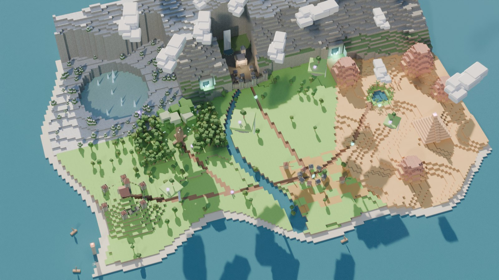

| | |
|---|---|
| 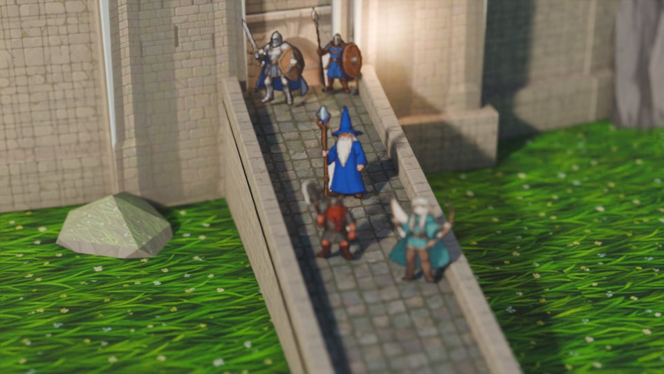 | 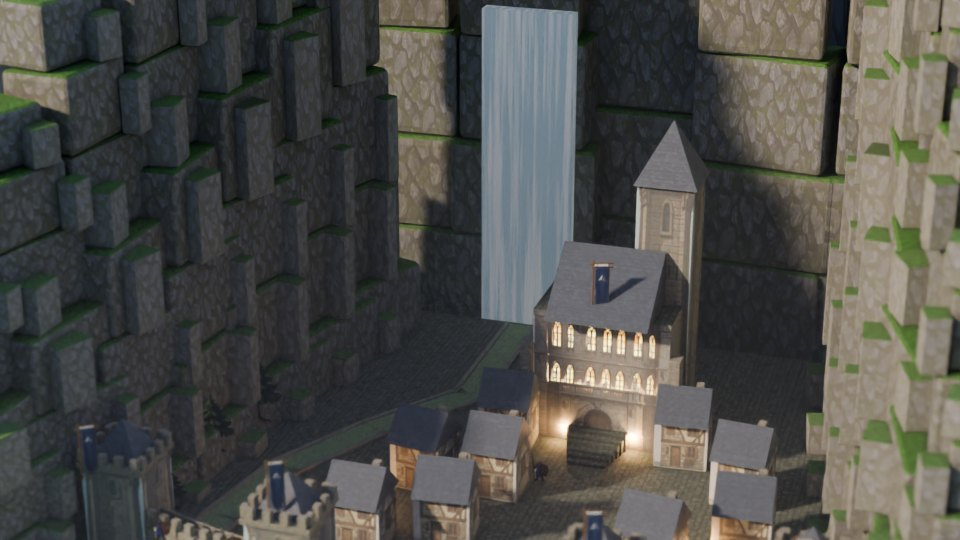 |
| 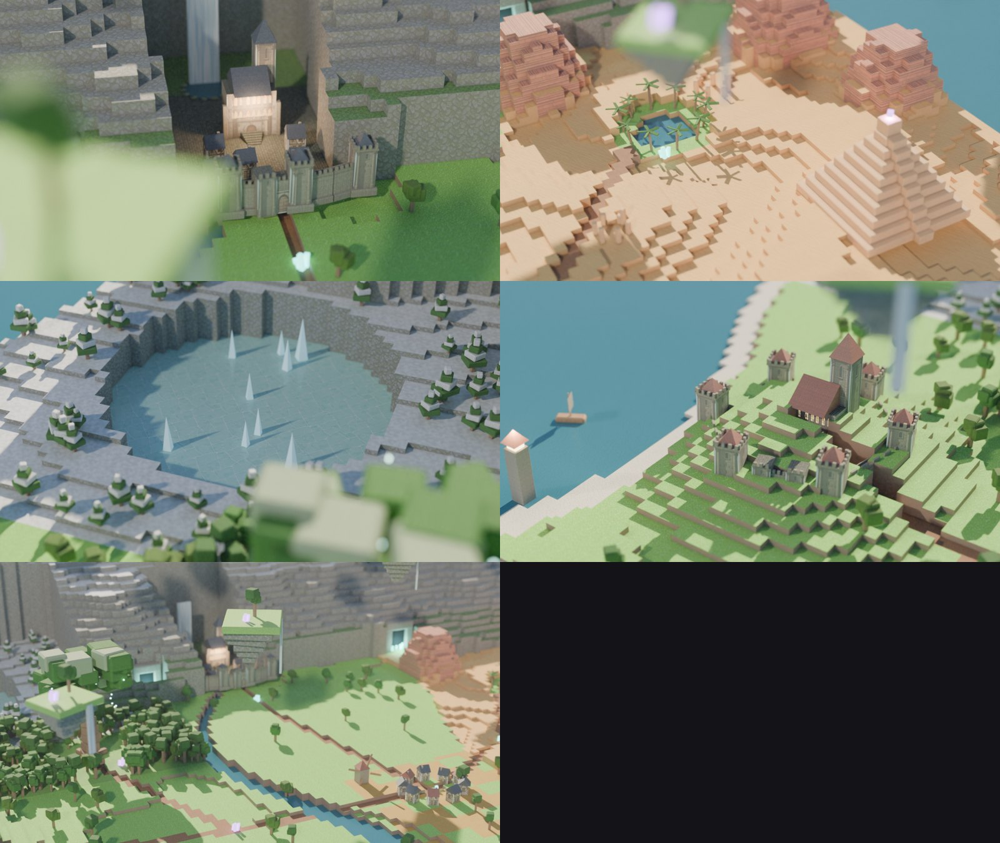 | 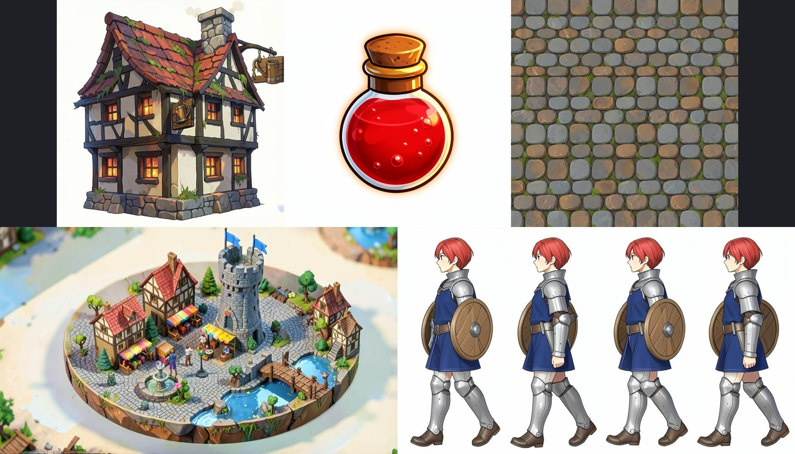 |

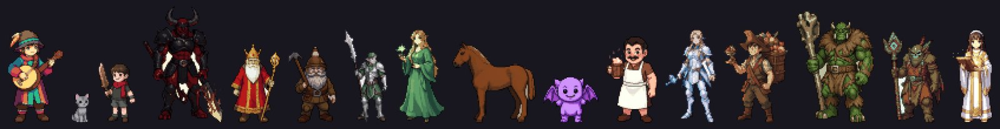

*Todo lo de esta página está generado con NV Asset Forge: texturas, fachadas y sprites con FLUX.2 (NVIDIA Build) y mundos montados y renderizados en Blender con los scripts de `examples/`.*

---

## Qué puede hacer

| Función | Qué hace | Dónde se ejecuta |
|---|---|---|
| **Pack coherente** ★ | Una frase → un LLM diseña la biblia de estilo y la lista de assets (héroe, enemigos, props, iconos, texturas, fondo, VFX) y FLUX los pinta todos con las mismas reglas visuales | NVIDIA |
| **Autotiles** ★ | Dos texturas → tileset de 16 tiles con transición orgánica por esquinas (pixel con contorno o HD suave) + `.tsx` de Tiled + `.tres` de Godot 4 con terreno ya configurado | Local (navegador) |
| **Exportar a motor** ★ | ZIP listo para Godot 4 (`res://nvforge`), Unity (`Assets/NVForge`) o genérico, con `manifest.json` (prompt, semilla, modelo de cada asset) | Local |
| **Assets 2D** | Personajes, objetos, iconos, texturas repetibles, fondos, UI, efectos VFX y concept art | NVIDIA (FLUX.2 klein, FLUX.1) |
| **Modelos 3D pro en Blender** | Un LLM modela el asset con un kit de piezas, FLUX.2 pone las texturas y un modelo de visión lo revisa como director de arte | NVIDIA + Blender local |
| **Assets 3D por IA** | Modelos `.glb` desde texto con TRELLIS (cuando el servicio de NVIDIA está activo) | NVIDIA (TRELLIS) |
| **Elige tu modelo** | Cada usuario elige el modelo de imagen, de 3D y de LLM que quiera, o añade cualquier otro de build.nvidia.com por su ruta | — |
| **Optimizar prompt** | Un LLM convierte tu idea en un prompt profesional de dirección de arte | NVIDIA o tu LLM local (FreeLLMAPI) |
| **Colecciones de estilo** | Guía de estilo + imagen de referencia por proyecto para que todo el juego sea coherente | NVIDIA (FLUX Kontext) |
| **Variaciones** | El mismo personaje en otra pose, vista o con otro equipo | NVIDIA (FLUX Kontext) |
| **Animaciones 2D** | Idle, andar, correr, atacar, saltar, recibir daño, hechizo y morir → sprite sheet alineado con vista previa | NVIDIA + montaje local |
| **Editor 2D** | Quitar fondo, recortar, pixel art con paleta, hacer tileable, potencias de 2 | Local (navegador) |
| **Blender** | Limpieza de malla, escala real en metros, pivote en la base, LODs, exportación FBX / GLB / OBJ / .blend | Local (tu Blender) |
| **Render Blender** | Sprite sheets de 4/8/16 direcciones y render "hero" con Eevee o Cycles, fondo transparente | Local (tu Blender) |
| **Visor 3D** | Vista previa, wireframe, estadísticas, render rápido y miniaturas | Local (three.js) |
| **Mundos 2D-HD** ★ | Diseñador de mundos con hora del día (día, amanecer, atardecer, noche), vistas de juego con cámara RPG elevada y tilt-shift, y viñeta | NVIDIA + Blender |
| **Prototipo jugable** | Describes el juego y un LLM escribe un juego en Phaser con tus assets; lo puedes ir mejorando | NVIDIA (LLM de código) |

---

## Instalación (una sola vez)

1. Instala **Node.js 18 o superior** (versión LTS): https://nodejs.org
2. (Recomendado) Instala **Blender** gratis: https://www.blender.org/download/ (la app lo encuentra sola).
3. Crea tu API key gratuita en https://build.nvidia.com → entra en cualquier modelo → **Get API Key**.
4. Descarga este repo: botón verde **Code → Download ZIP** y descomprímelo (o `git clone`).

## Arrancar

| Sistema | Cómo |
|---|---|
| Windows | doble clic en `start.bat` |
| macOS | doble clic en `start.command` (la primera vez: clic derecho → Abrir) |
| Linux | `./start.sh` |

Se abre `http://localhost:7860`. Pega tu API key en **⚙ Ajustes** y genera tu primer asset.

---

## Flujo de trabajo recomendado

1. **Define el estilo del juego** en *Estilo del proyecto*: escribe la guía (paleta, técnica, ambiente) y, cuando tengas un asset que te guste, pulsa *Usar asset actual como referencia*.
2. **Genera personajes y objetos.** Marca *Copiar el estilo de la imagen de referencia* para que todo salga coherente.
3. **Anima** los personajes: elige la animación → *Generar fotogramas* → *Montar sprite sheet*.
4. **Pasa a 3D** lo que necesites: *→ 3D* sobre una imagen, o genera directamente con *Modelo 3D (concept → 3D)*.
5. **Blender**: *Optimizar + LODs + FBX* deja el modelo a escala real y listo para el motor; *Render Blender* crea sprite sheets isométricos para juegos 2D.
6. **Prototipo jugable**: Ctrl+clic en la biblioteca para elegir assets, describe el juego y pulsa *Crear juego*. Luego escribe cambios y pulsa *Mejorar seleccionado*.

---

## Modelos

Se eligen en el panel izquierdo para cada generación, o por defecto en Ajustes. Comprobados con la API real de NVIDIA en noviembre de 2026:

| Tipo | Por defecto | Estado |
|---|---|---|
| Imagen | **FLUX.2 klein 4B** (~2 s por imagen, máx. 4 pasos) | ✅ funciona |
| Imagen alternativa | FLUX.1 dev / schnell | ⚠️ a veces saturado (error 500) |
| LLM de prompts | **Nemotron 3.5 Lightning 30B** | ✅ ~2 s |
| LLM de código (Blender y juegos) | **MiniMax M3.1 flash** | ✅ (también Mistral Large 4, más lento) |
| Visión (director de arte) | **Nemotron 3.5 Super VL** | ✅ ~5 s |
| 3D por IA | TRELLIS | ⚠️ inestable en la nube; estable con NIM local |
| Edición con imagen propia (Kontext, imagen→3D) | — | ❌ la nube gratuita solo acepta sus imágenes de ejemplo; usa NIM local |

Cualquier otro modelo de build.nvidia.com se puede añadir escribiendo su ruta en Ajustes. Si un modelo no acepta algún parámetro, la app reintenta con los mínimos; si un modelo de código no existe, usa el LLM general.

**Lección aprendida:** el modelado 100 % autónomo por LLM todavía no da calidad de estudio de forma fiable. Lo que sí la da es una librería de **módulos diseñados** (como los de `examples/`) que el LLM compone y varía. Ese es el camino de la siguiente versión.

---

## Dónde se guardan los assets

```
library/
  MiJuego/
    project.json                       guía de estilo y referencia del proyecto
    2d/orc_knight_mx1a2b/              source.png · processed_01_64x171.png · meta.json
    2d/orc_knight_walk_mx1a9z/         frame_01..04.png · walk_sheet_96x128_n4.png
    3d/treasure_chest_mx1a3c/          model.glb · concept.png · thumb.png
                                       treasure_chest.fbx (LOD0-2) · treasure_chest_optimized.glb
                                       treasure_chest.obj · treasure_chest.blend
                                       treasure_chest_blender_8dir_256px_e30.png · treasure_chest_blender_hero.png
    games/plataformas_mx1b00/          index.html · game.json · versiones anteriores
  _papelera/                           lo que borras (recuperable)
```

Cada `meta.json` guarda el prompt original, el prompt optimizado, el modelo y la semilla, así que cualquier asset se puede reproducir.

**Por qué carpetas y no una base de datos:** Unity, Godot y Unreal importan carpetas directamente, Git/Git LFS lo versiona sin conversiones y no hay nada que se pueda corromper. En Ajustes puedes apuntar la biblioteca a:
- la carpeta de arte de tu proyecto (p. ej. `MiProyectoUnity/Assets/Generated`), para que aparezca en el motor al instante;
- una carpeta de OneDrive, Dropbox o Google Drive, para tener copia en la nube y en todos tus PCs.

---

## Blender

- Se detecta solo en las rutas habituales (Program Files, Steam, `/Applications`, `/usr/bin`, snap, flatpak…). Si no, pega la ruta de `blender.exe` en Ajustes y pulsa *Detectar*.
- Compatible con Blender 3.6, 4.x y 5.x.
- **Optimizar + LODs + FBX**: une las piezas, elimina vértices duplicados, corrige normales, escala a la altura indicada (metros), pone el pivote en la base, limita los triángulos y crea LOD1 (50 %) y LOD2 (25 %). El FBX lleva los LODs con nombres `_LOD0/_LOD1/_LOD2`, así que Unity crea el LOD Group solo.
- **Render Blender**: cámara ortográfica a la elevación que elijas, iluminación de tres puntos, fondo transparente y colores fieles (*Standard*). Eevee es rápido con GPU; Cycles usa tu GPU NVIDIA (OptiX/CUDA) si la hay.

---

## Ejecutar los modelos en tu propia GPU (opcional)

Con una GPU NVIDIA RTX y Docker (o WSL2 en Windows) puedes correr los modelos como NVIDIA NIM, sin límites ni colas:

```bash
export NGC_API_KEY=nvapi-...
docker run -it --rm --gpus all -e NGC_API_KEY -p 8001:8000 \
  -e NIM_MODEL_VARIANT=large:text+large:image nvcr.io/nim/microsoft/trellis:latest
docker run -it --rm --gpus all -e NGC_API_KEY -e HF_TOKEN -p 8000:8000 \
  nvcr.io/nim/black-forest-labs/flux.1-dev:latest
```

Después, en Ajustes, pon Imagen y 3D en **NIM local** (`http://localhost:8000` y `http://localhost:8001`).

## LLM local (FreeLLMAPI u otro compatible con OpenAI)

Ajustes → *LLM que optimiza los prompts* → **Local compatible OpenAI**. URL por defecto `http://localhost:31415/v1`, modelo `auto`. Si no responde, la app usa automáticamente el LLM de NVIDIA. Imagen y 3D siguen yendo con NVIDIA.

---

## Privacidad y seguridad

- Tu API key se guarda solo en `config.json`, en tu PC. Ese archivo está en `.gitignore` y nunca se sube.
- El servidor solo escucha en `127.0.0.1`: nadie de tu red puede usarlo.
- Solo se envían a NVIDIA los prompts y, para imagen→3D, variaciones y animaciones, la imagen de origen.

## Licencias de los modelos

La API de NVIDIA Build es un servicio de prueba con límites de uso. Revisa la licencia de cada modelo antes de un uso comercial: **FLUX.1-dev y FLUX.1-Kontext-dev** piden licencia comercial a Black Forest Labs; **TRELLIS** es MIT; consulta la ficha de cada modelo en build.nvidia.com para los demás.

## Diseñador de mundos (LLM + recetas + Blender)

Un mundo es una **receta JSON**: masas de tierra (círculos o contornos de costa), biomas, cordilleras, picos, mesetas, volcanes (con nieve o lava), lagos (helados o no), ríos, caminos, gargantas, lugares emblemáticos (fortaleza, castillo, aldea, puerto, oasis, campamento, Árbol del Mundo…) y dispersión de módulos. `examples/world/worldgen.py` la construye en Blender con los módulos de calidad en ~45 s.

En la app (panel *Diseñador de mundos*):
1. **Parte de una plantilla** (Aethermoor, Kanto, Madagascar, Australia) o de cero.
2. **Describe** el mundo o los cambios en lenguaje natural: el LLM de NVIDIA escribe/modifica la receta, se valida y Blender la construye.
3. Un **director de arte** (modelo de visión) revisa el mapa y el LLM aplica una ronda de mejoras.
4. **Edita la receta** a mano en el propio panel y reconstruye sin LLM.
5. Elige **hora del día** (día, amanecer, atardecer, noche: sol, cielo, faroles y ventanas cambian juntos) y genera **vistas de juego**: cámara RPG elevada y cercana sobre cada lugar emblemático, como la que verá el jugador.

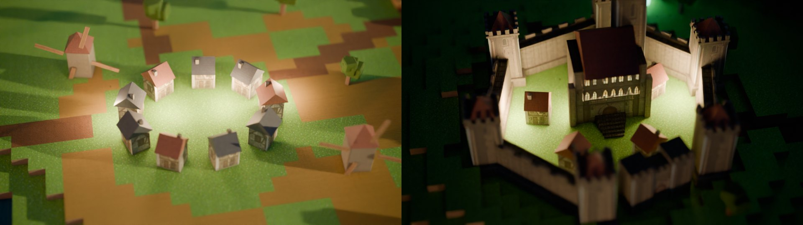
*Vistas de juego generadas automáticamente: la aldea al atardecer y el castillo de noche con las ventanas encendidas.*

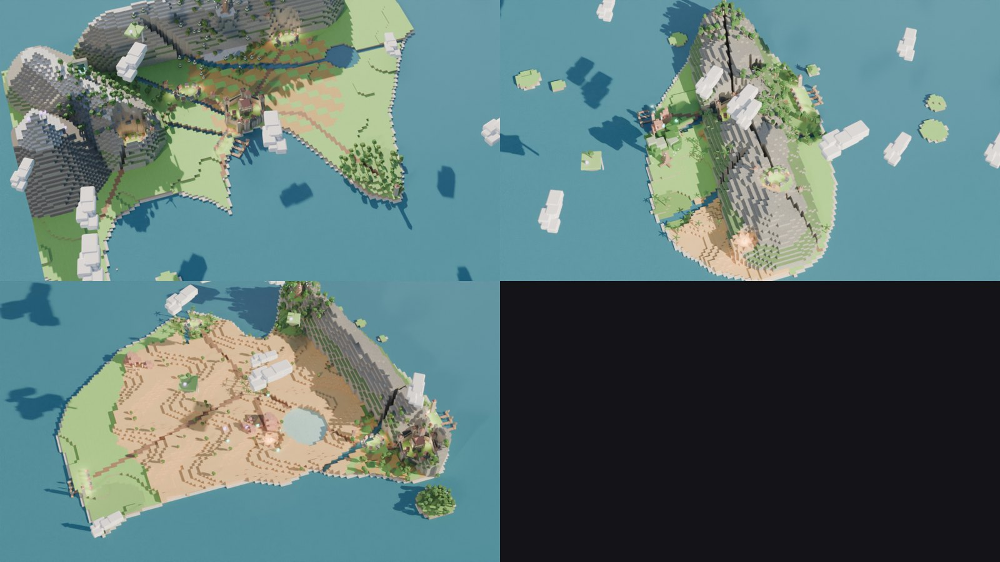
*Plantillas editables: Kanto, Madagascar y Australia en estilo cúbico 2D-HD.*

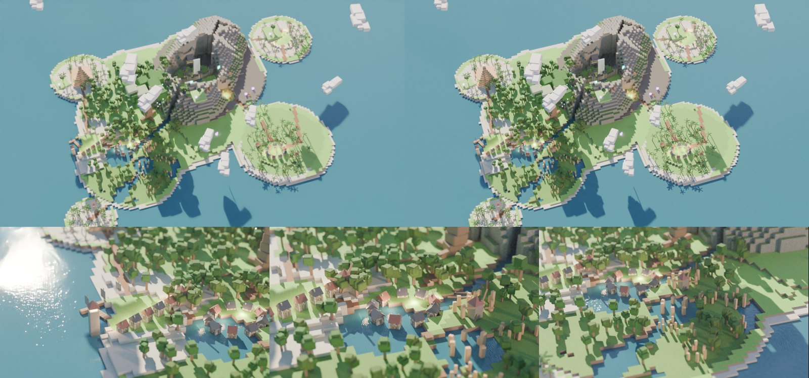
*"Cinderhaven", un archipiélago volcánico diseñado al 100 % por el LLM a partir de una frase, con planos de zona automáticos.*

```bash
blender -b -P examples/world/worldgen.py -- --spec examples/world/worlds/kanto.json --res 1600x900
blender -b -P examples/world/worldgen.py -- --spec examples/world/worlds/aethermoor.json --shot play0 --time dusk
```

## Packs, autotiles y exportación

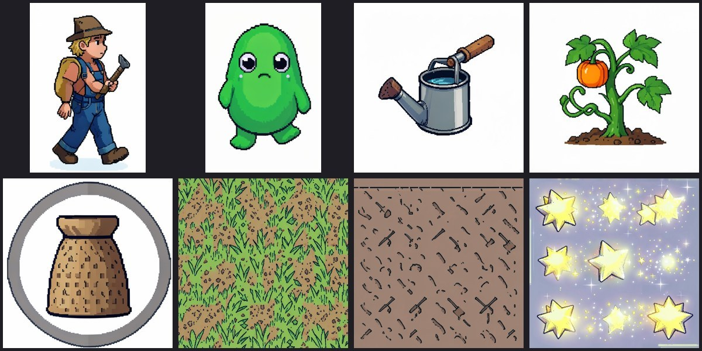
*"Cozy farming RPG on a floating island" → 8 assets con la misma biblia de estilo (pixel art 16-bit): héroe, enemigo, props, icono, dos texturas de suelo y un VFX.*

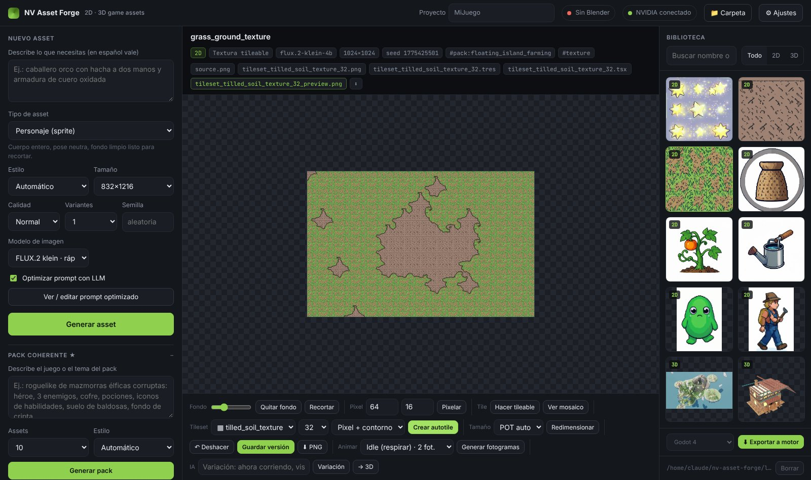
*Autotile hierba + tierra labrada generado en el navegador a partir de dos texturas del pack, con su `.tsx` y su `.tres`.*

- **Pack coherente**: panel *Pack coherente*, describe el juego ("roguelike de criptas élficas: héroe, 3 enemigos, cofre, pociones, iconos, suelo, fondo") y elige cuántos assets. Todos comparten la misma biblia de estilo (que además se guarda como guía del proyecto) y quedan etiquetados `pack:nombre` en la biblioteca.
- **Autotiles**: abre una textura, elige el segundo terreno en *Tileset*, el tamaño de tile y el modo (*Pixel + contorno* o *Suave HD*). Se guardan en el asset el tileset PNG (4×4 tiles, terreno por esquinas), una vista previa de mapa, el `.tsx` (Wang set de esquinas para Tiled) y el `.tres` (TileSet de Godot 4 con terrain set *Match Corners*). El ruido de la frontera es periódico, así que los tiles encajan sin costuras en cualquier combinación.
- **Exportar a motor**: marca assets con Ctrl+clic, elige Godot 4 / Unity / genérico y pulsa *Exportar*. El ZIP se genera sin dependencias e incluye un README con los ajustes de importación (p. ej. filtro *Nearest* para pixel art).

## Ejemplos 2D-HD (Blender)

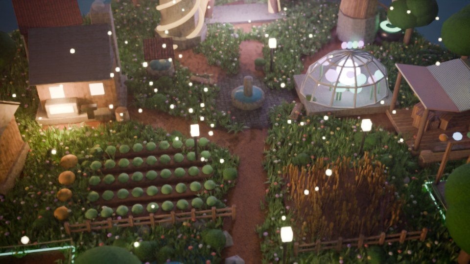
*The Last Acre (`examples/last_acre/acre.py`): isla construible con caminos de tierra fundidos con la hierba, plaza, solar libre y edificio en obras, vegetación por capas (hierba, flores, helechos, piedras, arbustos) instanciada con Geometry Nodes, y variantes de día, amanecer, atardecer y noche.*

Scripts listos para ejecutar con Blender 4.x / 5.x (`blender -b -P script.py -- opciones`):

| Ejemplo | Qué es | Comando |
|---|---|---|
| `examples/world/build_world.py` | **Aethermoor**: continente JRPG de cubos con mar, playas, llanuras, bosque y Árbol del Mundo, desierto con pirámide, lago helado, cordillera, cuevas, castillo, fortaleza, islas flotantes y nubes | `--shot world\|fortress\|desert\|frost\|castle\|isles --res 1600x900` |
| `examples/fortress/build_fortress.py` | Fortaleza modular en un abismo: muralla, torres, puerta, torreón, casas, rampa, estratos, cascada, arroyo; personajes pixel art; exporta cada módulo a GLB/FBX | `--shot hero\|gate\|keep\|party\|abyss --pixel --export-modules` |
| `examples/last_acre/acre.py` | **The Last Acre**: el Acre flotante con forja, invernadero, alquimia, observatorio, portal, mercado, huerto, trigal, caminos, plaza, solares construibles y la Red de Raíces hacia otros Acres | `--shot play\|play_farm\|play_build\|hero\|iso\|network --time day\|dawn\|dusk\|night --state neutral\|conquer\|destroy` |
| `examples/diorama_2dhd/diorama_2dhd.py` | Diorama de fantasía oscura con 5 facciones, materiales pixel art PBR, billboards, tilt-shift f/1.8, volumen, AgX y Glare | `--engine CYCLES\|EEVEE --shot hero\|humans\|demons` |

La técnica: **geometría low poly + imágenes FLUX muy detalladas encima** (fachadas con UV por cara, texturas tileables en proyección de caja) + shaders que fingen detalle (oclusión, desgaste en aristas, musgo en la base, hierba según la normal) + **sprites pixel art reales** (resolución nativa, paleta cerrada, interpolación Closest) + cámara de maqueta.

## Para desarrolladores

- `server.js`: servidor HTTP sin dependencias (Node 18+). API: `/api/generate` (trabajos: assets, `pack`, `world`, `game`…), `/api/export` (ZIP para motores), `/api/assets`, `/api/project`, `/api/games`, `/api/blender`, `/api/config`.
- `public/index.html`: toda la interfaz en un archivo (three.js desde CDN).
- `blender/nvf_blender.py`: operaciones `process` y `render`; se puede usar sola: `blender -b -P blender/nvf_blender.py -- trabajo.json`.
- Atajo: `Ctrl+Enter` en la descripción para generar.
